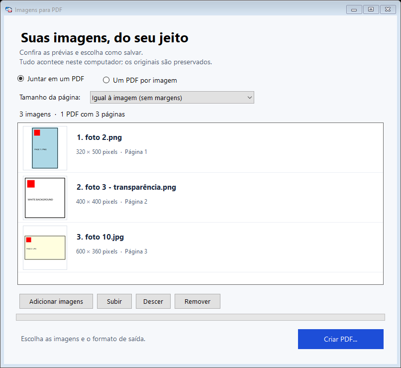

<p align="center">
  
</p>

# Imagens para PDF

Selecione imagens JPG e PNG no Windows e escolha entre reunir tudo em um PDF ou criar um PDF para cada imagem. Funciona localmente, sem enviar arquivos para serviços externos.

[Baixar a versão para Windows](https://github.com/felpashow/imagens-para-pdf/releases/latest)

<p align="center">
  
</p>

## Recursos

- Conversão de JPG, JPEG e PNG para PDF.
- Prévias das imagens na lista, com nome e dimensões.
- Um PDF único com várias páginas ou um PDF individual por imagem.
- Ordem inicial pelo nome, com ajuste pelos botões Subir e Descer.
- Página no tamanho da imagem, sem margens, ou A4 sem recortar.
- Confirmação na própria janela ao salvar, sem perguntar se deseja abrir o arquivo.
- Tratamento da orientação EXIF e transparência de PNG sobre fundo branco.
- Integração com o menu de botão direito do Explorador.
- Imagens originais preservadas.
- Código C# com Windows Forms e .NET Framework 4.x, sem bibliotecas de terceiros.

## Instalar e usar

1. Baixe o pacote do aplicativo na área [Releases](https://github.com/felpashow/imagens-para-pdf/releases).
2. Extraia o ZIP e execute `Instalar.cmd`.
3. Selecione uma ou várias fotos JPG/PNG e clique com o botão direito.
4. Escolha **Criar PDF com as imagens**. No Windows 11, a opção fica dentro de **Mostrar mais opções**.
5. Confira as prévias e escolha **Juntar em um PDF** ou **Um PDF por imagem**.
6. Escolha o tamanho da página: **Igual à imagem (sem margens)** ou **A4**.
7. Clique em **Criar PDF...** ou **Criar PDFs...**. No modo individual, escolha a pasta de destino.

No modo individual, o nome da imagem vira o nome do PDF. Se o destino já existir, o programa acrescenta `(2)`, `(3)` e assim por diante, preservando os arquivos anteriores. Ao terminar, a confirmação aparece na janela, sem diálogo para abrir os resultados.

O programa também pode ser aberto diretamente pelo executável. A instalação é feita apenas para o usuário atual, em `%LOCALAPPDATA%\FotosParaPdf`.

Para atualizar, feche a janela do aplicativo e execute `Instalar.cmd` do novo pacote. Para remover a integração, execute `Desinstalar.cmd`.

## Compilar o código

É necessário um Windows com o compilador do .NET Framework 4.x em `%WINDIR%\Microsoft.NET\Framework64\v4.0.30319\csc.exe`.

Na raiz do repositório, execute no PowerShell:

```powershell
.\codigo-fonte\Recompilar.ps1
```

O script gera `FotosParaPdf.exe` na raiz. O executável gerado fica fora do controle de versão, conforme o `.gitignore`. Após compilar, você pode abrir o programa ou executar `Instalar.cmd`.

## Estrutura

```text
assets/          Ícones PNG/ICO e prompt usado na geração da imagem
codigo-fonte/    Código C# e script de compilação
docs/            Captura de tela da interface com uma imagem de teste
Instalar.cmd     Adiciona a opção ao menu de botão direito
Desinstalar.cmd  Remove a integração
LEIA-ME.txt      Instruções e detalhes de funcionamento
```

## Funcionamento

O programa cria a estrutura de um PDF e incorpora cada imagem em uma página. Por padrão, a página acompanha as dimensões da imagem, sem margens. O tamanho físico usa a resolução DPI informada pela imagem, com 96 DPI quando não há uma resolução válida. A alternativa A4 ajusta a imagem inteira na página, preservando sua proporção. JPG RGB sem rotação é incorporado sem recompressão; PNG usa compressão sem perdas após a composição do fundo branco. Os demais JPGs são normalizados em RGB com qualidade 95, mantendo a resolução em pixels.

A integração do menu chama o executável diretamente. Invocações simultâneas enviam os caminhos das fotos para uma única janela por meio de um pipe local, limitado ao mesmo usuário e sessão. O PDF é montado primeiro em um arquivo temporário e só substitui o destino depois da conversão completa.

## Limites conhecidos

- O PDF contém imagens; esta versão não realiza OCR.
- O menu usa a integração clássica do Windows.
- O menu aceita até 100 arquivos por seleção nesta modalidade. Mais imagens podem ser adicionadas pela janela.
- Novas seleções são adicionadas à janela aberta; confira os itens antes de salvar.
- HEIC e WebP não são aceitos nesta versão.

## Validação da versão 1.3

Foram verificados os modos único e individual, nomes repetidos sem sobrescrita, falha parcial com imagem inválida, páginas no tamanho da imagem sem margens, tamanho físico em 300 DPI, A4, orientação EXIF, transparência, JPG em escala de cinza e CMYK e preservação dos originais. O agrupamento de invocações simultâneas foi verificado. As prévias e as páginas renderizadas foram inspecionadas visualmente.

A conversão foi validada programaticamente. O fluxo pelo menu do Explorador precisa ser verificado no Windows de destino.

## Versão atual

O pacote instalável da versão **1.3.0** inclui o executável, o ícone e os comandos para instalar e desinstalar a integração. O executável mantém o nome `FotosParaPdf.exe` para compatibilidade com instalações anteriores.

Referências: [modelo de seleção do Shell](https://learn.microsoft.com/en-us/windows/win32/shell/how-to-employ-the-verb-selection-model) e [pipe local do .NET](https://learn.microsoft.com/en-us/dotnet/api/system.io.pipes.namedpipeserverstream).
